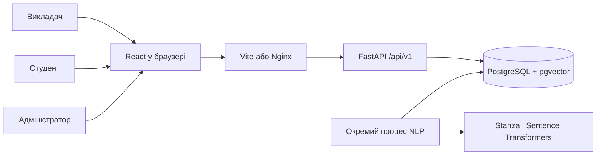

# Архітектура підсистеми

Рішення працює автономно. Інтеграція з університетською системою можлива через версійований JSON API. Контракт університетської системи в матеріалах не визначено.

API перевіряє роль, прив’язку до курсу й видимість об’єкта. Подання зберігається в транзакції зі станом `queued`. Воркер забирає завдання блокуванням рядка, запускає локальний аналіз та атомарно додає результат. Повторний запуск додає версію історії. Рішення викладача зберігаються окремими записами. Затвердження варіації та оцінювання відповіді можна виконати однією транзакцією.
