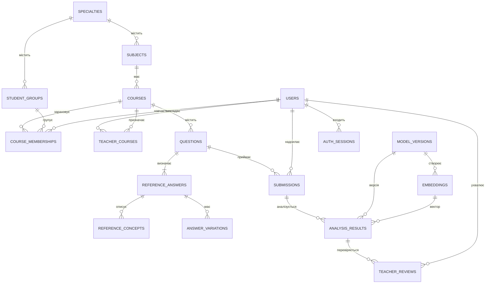

# Схема даних PostgreSQL



| Таблиці | Вміст та інваріанти |
| --- | --- |
| `users`, `auth_sessions`, `login_throttle` | Унікальна нормалізована пошта, Argon2id, роль і активність. Refresh-токени зберігаються як хеші. Ліміти входу зберігаються між процесами. |
| `specialties`, `subjects`, `courses`, `student_groups` | Довідники, рік, статус, видимість результатів і пороги курсу. Унікальні код спеціальності й складені ключі дисципліни, групи та курсу. |
| `teacher_courses`, `course_memberships` | Унікальні пари викладач–курс і студент–курс, належність до групи й прапорець доступу. |
| `questions`, `reference_answers`, `reference_concepts` | Статуси питання, один або кілька еталонів, поняття, ваги, синоніми та змістові правила. Публікація перевіряє наявність еталона. |
| `answer_variations` | Прив’язка до еталона, хеш нормалізованого формулювання, статус, автор, дати й викладач. Унікальний хеш у межах еталона. |
| `submissions` | Оригінальний текст, знімок питання, група на час надсилання, ключ повторного запиту й стан черги з орендою. |
| `analysis_results`, `teacher_reviews` | Новий рядок для кожного завершеного аналізу й рішення. Результат містить знімок параметрів та найближчого навчального матеріалу. |
| `model_versions`, `embeddings`, `embedding_jobs` | Версія і розмірність, pgvector-вектори за хешем тексту та черга попереднього обчислення для еталонів і затверджених варіацій. |
| `system_settings`, `audit_log` | Глобальні параметри, сигнал воркера й журнал змін. |

Міграції Alembic послідовно додають розширення `vector`, реляційну схему, індекси й чергу векторизації. B-tree покриває зв’язки курсу, студента, статусів, дати та останніх аналізів. HNSW-індекси за cosine призначені для 384 і 768 вимірів. Аналіз конкретного питання обчислює точну відстань через pgvector для всіх дозволених кандидатів. Це зберігає повноту порівняння після фільтрації за питанням і статусом.

```bash
alembic -c backend/alembic.ini current
alembic -c backend/alembic.ini upgrade head
```

Архівні питання та формулювання зберігають зовнішні ключі й історію. Відновлення даних описано в [SECURITY.md](SECURITY.md).
